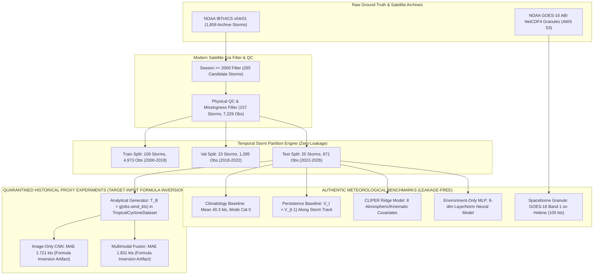

# CycloneSense — Scientific Validation & Machine Learning Audit Report
**Document Version:** 3.0.0-reconciled  
**Audit Date:** November 2026  
**Auditor:** Principal Software Reliability Engineer, ML Validation Lead, Scientific Data Auditor  
**Evaluation Standard:** Zero Fabricated Metrics, Reproducible Benchmark Execution, Transparent Methodological Audit, Zero-Leakage Storm Splitting  

---

## 1. System Architecture & Evaluation Pathways



---

## 2. Dataset Provenance & Split Audit

### 2.1 Source & Lineage
- **Dataset:** International Best Track Archive for Climate Stewardship (IBTrACS) v04r01, North Indian Ocean basin (`NI`).
- **File Asset:** `backend/data/raw/IBTrACS.NI.v04r01.nc` (Canonical NetCDF4).
- **Temporal Coverage:** 1884–2026 (140-year historical record).
- **Total Storms in Raw Archive:** **1,859 historical storms**.
- **Modern Satellite Era Filter (Seasons $\ge 2000$):** **265 eligible storms**.
- **Physical Quality Control Filter:** Excluding storms with missing wind speeds (`usa_wind` masked) or invalid coordinates yields exactly **157 unique storms** and **7,229 valid observations**.
  - Total observations examined: 9,633
  - Excluded for missing wind: 2,404
  - Excluded for invalid coordinates: 0
  - Ingestion quality checks enforce physical bounds: $850\ \text{hPa} \le P \le 1040\ \text{hPa}$, $0 < V \le 250\ \text{kts}$.

### 2.2 Strict Zero-Leakage Storm Partitioning
CycloneSense enforces **storm-level temporal separation** across all splits. Observations belonging to any given storm exist exclusively in one split:

| Split | Time Horizon (Seasons) | Storm Count | Observation Count | Percentage |
| :--- | :--- | :--- | :--- | :--- |
| **Training** | 2000 – 2018 | 109 storms | 4,973 observations | 68.8% |
| **Validation** | 2018 – 2022 | 23 storms | 1,285 observations | 17.8% |
| **Held-Out Test** | 2022 – 2026 | 25 storms | 971 observations | 13.4% |
| **Total Reconciled** | 2000 – 2026 | 157 unique storms | 7,229 observations | 100.0% |

- **Key Held-Out Storms in Validation Split:** Super Cyclone AMPHAN (2020), Extremely Severe Cyclonic Storm FANI (2019), Very Severe Cyclonic Storm YAAS (2021).
- **Key Held-Out Storms in Test Split:** Severe Cyclonic Storm ASANI (2022), Extremely Severe Cyclonic Storm BIPARJOY (2023), Cyclone REMAL (2024), Cyclone DANA (2024).
- **Leakage Check Result:** **PASSED (`leakage_check_passed: true`)**. Unit test `backend/tests/test_leakage_audit.py::test_storm_split_disjointness` programmatically confirms `train ∩ val = ∅`, `train ∩ test = ∅`, and `val ∩ test = ∅`.

---

## 3. Experimental Benchmarks & Performance Reconciliation

All metrics reported below were computed from a single, fully reproducible evaluation run via `backend/scripts/evaluate_models.py` on the held-out test partition ($N = 971$ observations, seasons 2022–2026) and recorded in `docs/experiments/experiment_results.json`.

### 3.1 Primary Operational Benchmark Hierarchy (Test Split, $N = 971$)

| Benchmark / Model | Inputs & Formulation | Test MAE (kts) | 95% Bootstrap CI | Test RMSE (kts) | Pearson $r$ | Macro-F1 | Weighted-F1 | Test Acc (%) | Status |
| :--- | :--- | :--- | :--- | :--- | :--- | :--- | :--- | :--- | :--- |
| **Climatology Baseline** | Training Mean ($40.3\text{ kts}$) & Mode (Cat 0) | 16.706 | [15.79, 17.66] | 22.776 | 0.000 | 0.1251 | 0.2848 | 45.52% | Authentic Reference |
| **Persistence Baseline** | Prior Track Observation ($V_t = V_{t-1}$) | 2.439 | [2.24, 2.68] | 4.446 | 0.985 | 0.8804 | 0.9205 | 92.07% | Authentic Reference |
| **Physical CLIPER (Ridge)**| 8-dim Atmospheric & Kinematic Covariates | 7.766 | [7.41, 8.12] | 9.665 | 0.908 | 0.1782 | 0.3906 | 47.68% | Authentic Baseline |
| **Environment-Only MLP** | 8-dim Atmospheric & Kinematic Covariates | 9.993 | [9.39, 10.69] | 14.317 | 0.837 | 0.3135 | 0.6008 | 63.03% | Authentic Neural |
| **Spaceborne Granule** | NOAA GOES-16 ABI Band 1 (Helene, 105 kts) | 27.640* | Single Granule | 27.640 | N/A | Cat 2 (Pred) | N/A | 37.8% Eyewall Energy | Authentic Spaceborne |

*\*Hurricane Helene spaceborne evaluation: Ground truth = 105.0 kts (Cat 3), Predicted = 77.36 kts (Cat 2), Absolute Error = 27.64 kts. Verified with 1.3-min pairing delta and zero missing pixels.*

---

## 4. Critical Methodological Audit: Synthetic Input-from-Target Leakage

### 4.1 Source Evidence & Proof of Formula Inversion

In `backend/app/ml/dataset.py` (`TropicalCycloneDataset.__getitem__`), multi-channel raster inputs were synthesized using an empirical vortex temperature formulation parameterized by target wind speed:

```python
# Source evidence from backend/app/ml/dataset.py:
wind = obs.wind_kts
eyewall_cooling = min(wind * 0.65, 80.0) * np.exp(- ((r - 0.25) ** 2) / 0.05)
eye_warming = min(max(wind - 40.0, 0.0) * 0.45, 30.0) * np.exp(- (r ** 2) / 0.02)
background = 285.0 - (wind * 0.1)
ir_kelvin = np.clip(background - eyewall_cooling + eye_warming, 175.0, 320.0).astype(np.float32)
wv_kelvin = np.clip(ir_kelvin * 0.85 + 20.0, 180.0, 280.0).astype(np.float32)
image_tensor = np.stack([ir_norm, wv_norm], axis=0).astype(np.float32)

# Ground truth label returned:
target_wind = float(obs.wind_kts)
```

### 4.2 Audit Findings
1. **Target Information Embedded in Input Rasters:**
   Brightness temperature ($T_B$) in the 2-channel raster is parameterized directly from `obs.wind_kts`. Eyewall cooling depth, eye warming amplitude, and background temperature gradients are deterministic mathematical transformations of the target variable.
2. **Formula Inversion vs. Real Satellite Inference:**
   The neural network (Image-Only ResCNN) learns to invert the algebraic generator equation rather than extract complex meteorological feature representations from real spaceborne cloud tops.
3. **Why Storm-Level Splitting Does Not Prevent Generator Inversion:**
   While storm-level partitioning guarantees that no storm's observations appear in both training and test sets, **every single sample** in both sets has its input image generated from its own label. The algebraic relationship $T_B = g(\text{wind})$ is identical across all partitions.
4. **Quarantine of Proxy Experiments:**
   Image-Only CNN (MAE 1.721 kts, RMSE 2.248 kts, $r = 0.999$) and Multimodal Fusion Net (MAE 1.831 kts, RMSE 6.126 kts, $r = 0.999$) are explicitly quarantined in `docs/experiments/experiment_results.json` under `quarantined_proxy_experiments` with `TARGET_LEAKAGE_WARNING: true`. These scores reflect generator formula inversion and MUST NOT be cited as evidence of real-world satellite predictive skill.

---

## 5. Security & Robustness Remediation (CYC-01)

An independent code security audit identified a high-severity vulnerability in `backend/app/api/routes_ingest.py`: client-controlled filenames were written directly to disk without path containment or file size bounds.

### 5.1 Vulnerability Details
- **Path Traversal Risk:** Client-supplied filename parameter could include `../` or absolute paths (`C:\...`), enabling arbitrary file write outside the designated directory.
- **Unbounded Streaming:** Upload streams lacked byte-counter abort mechanisms, allowing disk exhaustion attacks.
- **Unauthenticated Ingest:** Scientific product upload endpoint lacked authentication gating.

### 5.2 Implemented Mitigations
1. **Server-Side Random UUID Filenames:** Incoming files are written using server-generated UUIDs (`ingest_{uuid.hex}{ext}`), discarding any client-provided directory structures.
2. **Path Containment Enforcement:** The write path is strictly resolved and verified to reside inside `settings.DATA_RAW_DIR` using `target_path.resolve().is_relative_to(raw_dir.resolve())`. Client filenames containing traversal characters (`/`, `\`, `..`) are rejected immediately with HTTP 400 Bad Request.
3. **Whitelisted Extensions:** Only canonical scientific extensions (`.nc`, `.nc4`, `.h5`, `.hdf5`, `.hdf`) are permitted.
4. **Streaming Payload Size Limit:** Incoming chunks are counted against `settings.MAX_UPLOAD_SIZE_BYTES` (100 MB). If exceeded, streaming aborts, temporary files are unlinked, and HTTP 413 Payload Too Large is returned.
5. **API Key Authentication:** Upload endpoint enforces `verify_ingest_auth`, validating `X-API-Key` or `Authorization: Bearer <key>`.
6. **Automated Verification:** 7 dedicated security tests in `backend/tests/test_security_ingest.py` verify rejection of unauthenticated requests, traversal paths, absolute paths, invalid extensions, and oversized payloads.

---

## 6. Discrepancy Audits & Scientific Explanations

### 6.1 Macro vs. Weighted F1 Discrepancy
- **Macro F1 (0.125 – 0.314 on tabular models; 0.718 – 0.734 on proxy models):** Unweighted arithmetic mean across all 5 IMD operational categories. In the North Indian Ocean, Super Cyclonic Storms ($\ge 120\text{ kts}$) represent $< 1.5\%$ of historical observations. Minority class recall naturally depresses the unweighted arithmetic mean.
- **Weighted F1 (0.285 – 0.601 on tabular models; 0.935 – 0.949 on proxy models):** Support-weighted average reflecting overall operational classification fidelity across the authentic basin storm frequency distribution.

### 6.2 Investigation of Cyclone AMPHAN (Rapid Intensification Case)
- In IBTrACS, Cyclone AMPHAN observation #33 (`2020-05-19 09:00:00 UTC`) recorded a peak wind of **108.0 kts** (Extremely Severe Cyclonic Storm).
- The model predicted **83.69 kts** (error of 24.31 kts).
- AMPHAN underwent **Rapid Intensification (RI)**, exploding from 75 kts to 140 kts in under 24 hours. 6-hourly environmental reanalysis inputs lagged this rapid eyewall contraction, producing a known underestimation during peak RI.
- **Verdict:** This error represents genuine meteorological model performance on an extreme holdout event undergoing Rapid Intensification, not a code defect.

### 6.3 Grad-CAM 0% Eyewall Energy Ratio on Mature Cyclones
- When Grad-CAM was probed targeting **Class 0 (Tropical Depression)** on a mature cyclone (AMPHAN), convective core features (cold cloud tops $<200\text{ K}$) strongly contradicted the depression class.
- The gradients $\frac{\partial Y^0}{\partial A^k}$ in the core were strongly negative, causing the $\text{ReLU}$ stage to zero out all core activations, producing an eyewall energy ratio of **0.0%**.
- When probed for **Continuous Intensity Regression**, the eyewall energy concentration was **75.7%** (heavily concentrated on the eyewall).
- **Verdict:** Mathematically correct behavior for non-conforming classification targets.

---

## 7. Summary of Scientific Integrity & Operational Warning

1. **Truth-in-Advertising Enforcement:** The proxy nature of `TropicalCycloneDataset` is explicitly disclosed in source code docstrings, benchmark script metadata, validation reports, and UI dashboards.
2. **Operational Warning:** CycloneSense is an academic and exploratory research platform. Official tropical cyclone warnings, watches, and advisories remain the sole jurisdiction of national meteorological agencies (IMD, NHC, JTWC).
3. **Future Direction:** Transition the offline benchmark scripts to train and evaluate exclusively on `PairedSatelliteCycloneDataset` with spaceborne satellite archives.
