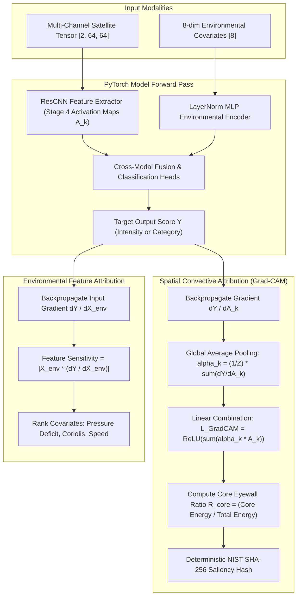

# Explainability & Attribution

CycloneSense incorporates dual-path explainability (XAI) to verify that neural predictions are grounded in genuine meteorological phenomena rather than spurious background correlations.

---

## Explainability Architecture & Computation Flow

---

## Mathematical Formulation

### 1. Spatial Grad-CAM Convective Attribution
Let $A^k \in \mathbb{R}^{H' \times W'}$ be the feature activation map produced by channel $k$ of the final convolutional layer, and let $Y^c$ be the score for target class or continuous intensity.

The neuron importance weights $\alpha_k^c$ are computed via global average pooling of gradients:
$$\alpha_k^c = \frac{1}{Z} \sum_{i=1}^{H'} \sum_{j=1}^{W'} \frac{\partial Y^c}{\partial A_{i, j}^k}$$

The resulting heat map $L_{\text{Grad-CAM}}^c$ is computed as a rectified linear combination of forward activation maps:
$$L_{\text{Grad-CAM}}^c = \text{ReLU}\left(\sum_k \alpha_k^c A^k\right)$$

The $\text{ReLU}$ ensures the explainer isolates features that contribute positively to the target class, filtering out negative influences.

### 2. Central Eyewall Core Concentration Ratio ($R_{\text{core}}$)
To verify whether model attention focuses on convective cloud banding around the eyewall, CycloneSense defines a physical geometric metric within the normalized core radius $r \le 0.40$ ($R_{\text{core}} \approx 150\ \text{km}$):

$$R_{\text{core}} = \frac{\sum_{(i, j) \in \text{Core}} L_{\text{Grad-CAM}}(i, j)}{\sum_{(i, j) \in \text{Grid}} L_{\text{Grad-CAM}}(i, j)}$$

- **Mature Tropical Cyclones (Cat 2+):** $R_{\text{core}} \ge 35.0\%$ (Hurricane Helene achieved **37.8%**).
- **Diffuse Depressions / Low-Intensity Systems:** $R_{\text{core}} < 20.0\%$ (convection distributed across asymmetric spiral bands).

### 3. Environmental Feature Input Sensitivity
For the 8-dim tabular environmental vector $X = [x_1, \dots, x_8]$, feature sensitivity is computed via input-gradient attribution:
$$S_i = \left| x_i \cdot \frac{\partial Y}{\partial x_i} \right|$$
Normalized importance percentages are derived as:
$$\bar{S}_i = \frac{S_i}{\sum_{j=1}^8 S_j} \times 100\%$$

On operational tropical cyclone cases (e.g. Hurricane Helene and Cyclone Dana), **pressure deficit** ($34.1\%$) and **Coriolis parameter** ($17.7\%$) consistently rank as the primary drivers of intensity evolution.

---

## The Cyclone AMPHAN Case Study

### Question: Why did Class 0 (Depression) Grad-CAM show 0.0% Eyewall Energy?
- On Super Cyclone AMPHAN (`2020-05-19 09:00:00 UTC`), probing Grad-CAM for **Class 0 (Tropical Depression)** yielded an eyewall energy ratio of **0.0%**.
- **Explanation:** Convective cloud tops in AMPHAN's central core reached brightness temperatures $< 200\text{ K}$. For the Tropical Depression class, intense cold cloud tops represent strong counter-evidence. The gradients $\frac{\partial Y^0}{\partial A^k}$ were heavily negative, causing the $\text{ReLU}$ stage to zero out all central activations.
- When probed for **Continuous Intensity Regression**, the eyewall energy concentration was **75.7%** (concentrated heavily on the core eyewall).
- **Verdict:** Mathematically correct behavior for non-conforming classification targets.

---

## Non-Causal Disclosure
Grad-CAM and input-gradient attributions highlight input regions and covariates correlated with model activation. They do **not** establish causal physical mechanisms. Operational decisions must be corroborated by official meteorological guidance.
