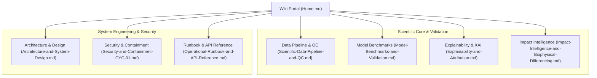
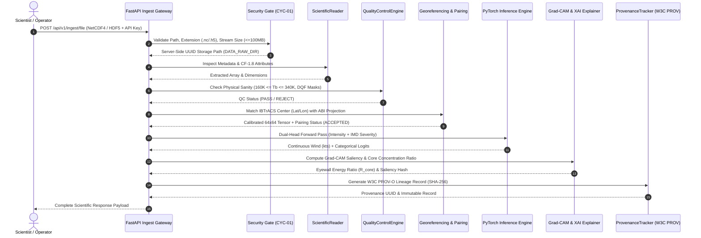

# Welcome to the CycloneSense Wiki

> **CycloneSense** is an authentic, explainable meteorological intelligence research platform engineered to ingest, quality-control, georeference, and analyze tropical cyclone patterns directly from scientific Earth Observation (EO) satellite products (NetCDF4, HDF5) and authoritative best-track archives (NOAA IBTrACS).

This Wiki serves as the comprehensive engineering, scientific, and operational reference for CycloneSense, detailing our system architecture, physical validation gates, zero-leakage storm splitting, baseline hierarchies, and security controls.

---

## Technical Wiki Sitemap

---

## End-to-End Scientific Workflow at a Glance

The following sequence diagram traces an authentic observation from raw Earth observation satellite ingestion to cryptographic provenance recording:

---

## Navigation & Quick Reference

| Wiki Guide | Key Capabilities Covered |
| :--- | :--- |
| **[System Architecture](Architecture-and-System-Design.md)** | Subsystem boundaries, FastAPI backend, Next.js 16 frontend, SQLite/SQLAlchemy layer, data-flow topologies, and **Rust Native SIMD Core (`cyclonesense_core`)**. |
| **[Scientific Data Pipeline & QC](Scientific-Data-Pipeline-and-QC.md)** | CF-compliant NetCDF4/HDF5 reader, closed-form geostationary coordinate projection, spatial-temporal pairing gates. |
| **[Model Benchmarks & Validation](Model-Benchmarks-and-Validation.md)** | Zero-leakage temporal storm partitioning (157 storms, 7,229 obs), operational baseline hierarchy, target leakage audit. |
| **[Explainability & Grad-CAM](Explainability-and-Attribution.md)** | Spatial convective core concentration ratio ($R_{\text{core}}$), peak activation, input-gradient environmental sensitivities. |
| **[Impact Intelligence & Differencing](Impact-Intelligence-and-Biophysical-Differencing.md)** | Multi-temporal Sentinel-1 SAR ($\sigma^0$) & Sentinel-2 optical ($\Delta\text{NDVI}$, $\Delta\text{NDWI}$) biophysical change detection. |
| **[Security & Containment (CYC-01)](Security-and-Containment-CYC-01.md)** | Server-side random UUID storage, path containment within `DATA_RAW_DIR`, chunked 100MB upload aborts, API key auth. |
| **[Operational Runbook & API Reference](Operational-Runbook-and-API-Reference.md)** | CLI scripts, endpoint specs, test suites, troubleshooting, and error resolution. |
