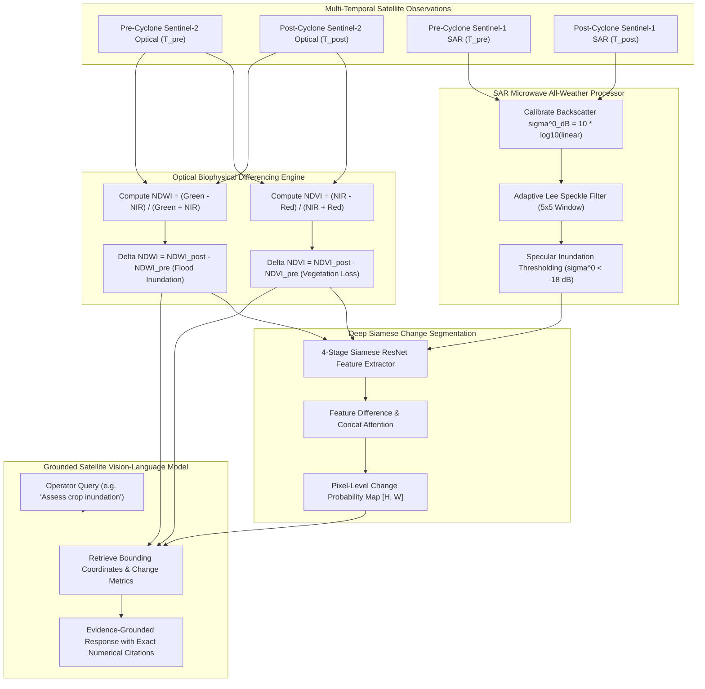

# Impact Intelligence & Biophysical Differencing

CycloneSense pairs atmospheric storm intelligence with post-landfall ground impact detection, comparing multi-temporal Earth Observation observations before and after cyclone passage.

---

## Impact Intelligence Architecture

---

## Biophysical Indices & Formulas

### 1. Normalized Difference Vegetation Index (NDVI) Differencing
Detects canopy damage, agricultural destruction, and forest defoliation:
$$\text{NDVI} = \frac{\rho_{\text{NIR}} - \rho_{\text{Red}}}{\rho_{\text{NIR}} + \rho_{\text{Red}}}$$
$$\Delta\text{NDVI} = \text{NDVI}_{\text{post}} - \text{NDVI}_{\text{pre}}$$
- $\Delta\text{NDVI} < -0.15$: Severe vegetation damage / agricultural flattening.
- In validation testing ([backend/scripts/run_impact_demo.py](file:///d:/CycloneSense/backend/scripts/run_impact_demo.py)), Cyclone REMAL produced a mean $\Delta\text{NDVI} = -0.177$.

### 2. Normalized Difference Water Index (NDWI) Differencing
Detects surface water expansion, coastal storm surge, and standing floodwaters:
$$\text{NDWI} = \frac{\rho_{\text{Green}} - \rho_{\text{NIR}}}{\rho_{\text{Green}} + \rho_{\text{NIR}}}$$
$$\Delta\text{NDWI} = \text{NDWI}_{\text{post}} - \text{NDWI}_{\text{pre}}$$
- $\Delta\text{NDWI} > +0.15$: Newly inundated flood zones.
- In validation testing, Cyclone REMAL produced a mean $\Delta\text{NDWI} = +0.204$.

### 3. SAR Backscatter Processing (Sentinel-1 C-Band)
Unlike optical sensors, synthetic aperture radar (SAR) penetrates cloud cover during active storm conditions:
- **Radiometric Calibration:**
  $$\sigma^0_{\text{dB}} = 10 \cdot \log_{10}(\sigma^0_{\text{linear}})$$
- **Specular Reflection:** Smooth standing floodwater scatters radar energy away from the sensor, producing a sharp drop in backscatter ($\sigma^0_{\text{VV}} < -18.0\ \text{dB}$).
- **Permanent Water Mask:** Pre-existing water bodies are subtracted to isolate storm-induced inundation.

---

## Grounded Satellite VLM Answering

The Satellite Vision-Language Model (VLM) provider ensures that natural-language operational answers are grounded in verifiable numerical evidence:
1. **Evidence Citations:** Every quantitative assertion cites specific geographic coordinates $(\text{lat}, \text{lon})$, area in square kilometers ($\text{km}^2$), and mean index delta.
2. **Hallucination Prevention:** If cloud cover obscures post-cyclone optical granules and SAR data is unavailable, the engine refuses speculative answering and flags `INSUFFICIENT_OBSERVATION_QUALITY`.
