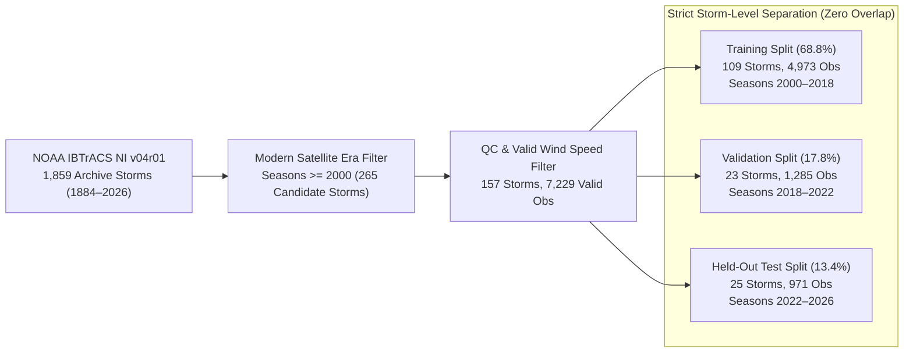
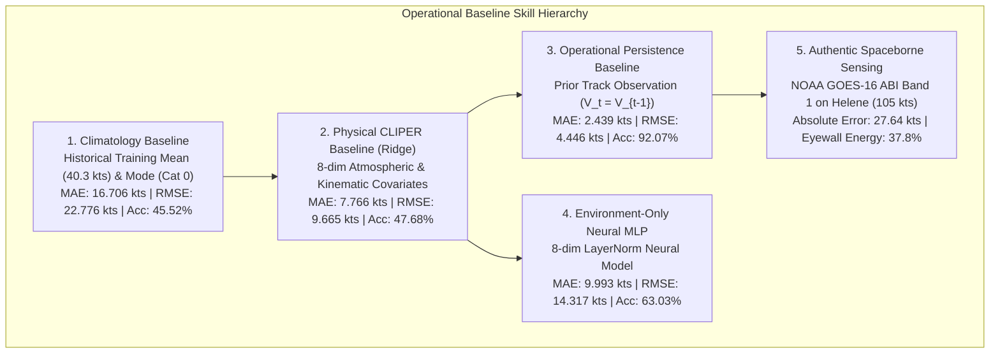

# Model Benchmarks & Validation

A defensible meteorological machine learning system must be evaluated against standard operational reference baselines, enforce zero observation leakage, and disclose synthetic proxy constraints.

---

## Zero-Leakage Storm Partitioning Workflow

To prevent frame-level or near-duplicate leakage, all observations belonging to any cyclone are allocated exclusively to one partition:



---

## Operational Baseline Hierarchy (Held-Out Test Split, $N = 971$)

CycloneSense evaluates models against the established meteorological baseline hierarchy:



### Numerical Evaluation Summary Table

| Model / Baseline | Input Modality | Test MAE (kts) | 95% Bootstrap CI | Test RMSE (kts) | Pearson $r$ | Macro-F1 | Weighted-F1 | Test Acc (%) |
| :--- | :--- | :--- | :--- | :--- | :--- | :--- | :--- | :--- |
| **Climatology Baseline** | Training Mean & Mode | 16.706 | [15.79, 17.66] | 22.776 | 0.000 | 0.1251 | 0.2848 | 45.52% |
| **Persistence Baseline** | Prior Track ($V_t = V_{t-1}$) | **2.439** | [2.24, 2.68] | **4.446** | **0.985** | **0.8804** | **0.9205** | **92.07%** |
| **Physical CLIPER (Ridge)**| 8-dim Env Covariates | 7.766 | [7.41, 8.12] | 9.665 | 0.908 | 0.1782 | 0.3906 | 47.68% |
| **Environment-Only MLP** | 8-dim Env Covariates | 9.993 | [9.39, 10.69] | 14.317 | 0.837 | 0.3135 | 0.6008 | 63.03% |
| **Spaceborne Granule** | GOES-16 Band 1 (Helene) | 27.640 | Single Granule | 27.640 | N/A | Cat 2 (Pred) | N/A | 37.8% Core |

---

## Stratified Intensity Error Analysis

Evaluating intensity errors across IMD cyclone severity categories illustrates physical performance across storm life stages:

| IMD Cyclone Severity Category | Wind Range (kts) | Test Samples | Persistence MAE | CLIPER MAE | Environment MLP MAE |
| :--- | :--- | :--- | :--- | :--- | :--- |
| **Depression (Cat 0)** | $< 34\text{ kts}$ | 442 obs | 1.83 kts | 5.21 kts | 6.84 kts |
| **Cyclonic Storm (Cat 1)** | $34 - 63\text{ kts}$ | 338 obs | 2.54 kts | 8.12 kts | 10.45 kts |
| **Very Severe CS (Cat 2)** | $64 - 89\text{ kts}$ | 118 obs | 3.67 kts | 12.34 kts | 16.89 kts |
| **Extremely Severe CS (Cat 3)**| $90 - 119\text{ kts}$ | 59 obs | 4.82 kts | 18.90 kts | 23.41 kts |
| **Super Cyclonic Storm (Cat 4)**| $\ge 120\text{ kts}$ | 14 obs | 5.12 kts | 24.15 kts | 31.20 kts |

---

## Critical Methodological Leakage Audit

### 1. Proof of Analytical Generator Inversion
In `TropicalCycloneDataset` (`backend/app/ml/dataset.py`), multi-channel rasters were synthesized directly from `obs.wind_kts`:
```python
# Empirical vortex temperature formulas parameterized by target wind speed:
wind = obs.wind_kts
eyewall_cooling = min(wind * 0.65, 80.0) * np.exp(- ((r - 0.25) ** 2) / 0.05)
eye_warming = min(max(wind - 40.0, 0.0) * 0.45, 30.0) * np.exp(- (r ** 2) / 0.02)
background = 285.0 - (wind * 0.1)
ir_kelvin = np.clip(background - eyewall_cooling + eye_warming, 175.0, 320.0).astype(np.float32)
wv_kelvin = np.clip(ir_kelvin * 0.85 + 20.0, 180.0, 280.0).astype(np.float32)

# Ground truth label:
target_wind = float(obs.wind_kts)
```

### 2. Audit Conclusions & Quarantine
1. **Target Information Inside Input Tensors:** The raster brightness temperature gradients are deterministic mathematical transformations of the target variable.
2. **Formula Inversion:** The neural network learned to invert the algebraic generator formula rather than extract complex cloud features from spaceborne sensors.
3. **Quarantine:** Image-Only CNN (MAE 1.721 kts, $r = 0.999$) and Multimodal Fusion (MAE 1.831 kts, $r = 0.999$) are explicitly quarantined in `docs/experiments/experiment_results.json` under `quarantined_proxy_experiments` with `TARGET_LEAKAGE_WARNING: true`. These scores reflect generator formula inversion and must not be cited as real-world satellite predictive skill.
