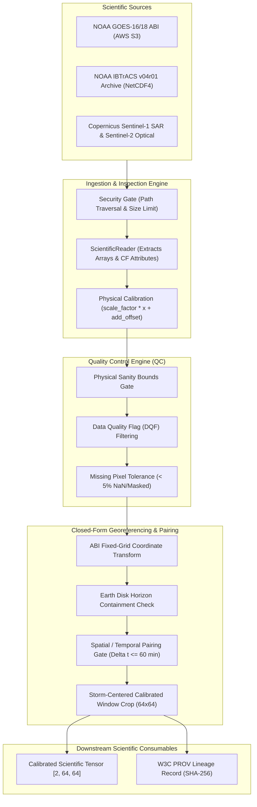

# Scientific Data Pipeline & Quality Control

CycloneSense is grounded in physical truth: it operates directly on canonical Earth Observation (EO) scientific formats (**NetCDF4**, **HDF5**) and authoritative meteorological archives (**NOAA IBTrACS v04r01**).

---

## Data Pipeline Architecture

---

## Physical Bounds & Quality Control Gates

Every raw variable is audited against physical laws before entering any numerical array or ML model. If an observation or raster violates these constraints, the ingestion pipeline rejects it immediately:

| Variable | Physical Bounds | Metric / Units | Rejection Action |
| :--- | :--- | :--- | :--- |
| **Infrared Brightness Temp ($T_B$)** | $160.0 \le T_B \le 340.0$ | Kelvin ($\text{K}$) | Fails QC; rejected as sensor artifact or corrupted calibration. |
| **Central Atmospheric Pressure ($P$)**| $850.0 \le P \le 1040.0$ | Hectopascals ($\text{hPa}$) | Observation excluded from training/evaluation sets. |
| **Maximum Sustained Wind ($V_{\max}$)**| $0.0 < V_{\max} \le 250.0$ | Knots ($\text{kts}$) | Observation excluded; missing wind accounted for in split stats. |
| **Missing Pixel Fraction** | $\le 5.0\%$ | Percent of total grid | Granule rejected if unmasked missing pixels exceed threshold. |
| **Data Quality Flags (DQF)** | $\text{DQF} == 0$ (Good) | Integer flag | Non-zero DQF pixels interpolated or masked per NOAA specifications. |

---

## Closed-Form Georeferencing for Geostationary Sensors

Geostationary radiometers (NOAA GOES-16 ABI, ISRO INSAT-3D) scan using fixed angular coordinates ($\lambda, \phi$). CycloneSense maps geographic coordinates $(\text{lat}, \text{lon})$ to raster grid pixels $(x, y)$ using the canonical NOAA geostationary projection equations:

### 1. Earth Ellipsoid & Satellite Constants (GRS80 / WGS84)
- Equatorial Radius: $r_{\text{eq}} = 6378.137\ \text{km}$
- Polar Radius: $r_{\text{pol}} = 6356.7523\ \text{km}$
- Satellite Height: $H = 42164.16\ \text{km}$ (Distance from Earth center to satellite orbit)
- Perspective Point Height: $h = H - r_{\text{eq}} = 35786.023\ \text{km}$
- Sub-Satellite Longitude: $\lambda_0 = -75.0^\circ$ (GOES-East / GOES-16)

### 2. Coordinate Transformation Equations
$$\phi_{\text{geo}} = \arctan\left(\frac{r_{\text{pol}}^2}{r_{\text{eq}}^2} \tan(\text{lat})\right)$$
$$r_c = \frac{r_{\text{pol}}}{\sqrt{1 - e^2 \cos^2(\phi_{\text{geo}})}}$$
$$s_x = H - r_c \cos(\phi_{\text{geo}}) \cos(\text{lon} - \lambda_0)$$
$$s_y = -r_c \cos(\phi_{\text{geo}}) \sin(\text{lon} - \lambda_0)$$
$$s_z = r_c \sin(\phi_{\text{geo}})$$

### 3. Scanning Angles & Pixel Offsets
$$x = \arcsin\left(\frac{-s_y}{\sqrt{s_x^2 + s_y^2 + s_z^2}}\right)$$
$$y = \arctan\left(\frac{s_z}{s_x}\right)$$
$$\text{col} = \frac{x - x_0}{\Delta x}, \quad \text{row} = \frac{y - y_0}{\Delta y}$$

If the argument to the arcsine or square root is invalid, the storm center is located behind the Earth's limb, and the pairing check fails loudly (`HORIZON_REJECTION`).

---

## Spaceborne Pairing Validation Protocols

To prevent mismatched satellite-storm associations, every observation pair must satisfy strict validation gates:
1. **Temporal Gating:** Maximum time delta between satellite acquisition timestamp and best-track observation timestamp must be $\le 60\ \text{minutes}$ (operational pairing on Hurricane Helene achieved **1.3 minutes**).
2. **Spatial Containment:** The cyclone radius ($r \approx 350\ \text{km}$) must fit entirely within the valid, non-masked coverage of the satellite granule.
3. **Calibrated Slicing:** Window cropping preserves true physical radiometer units (radiance in $\text{W}/(\text{m}^2\cdot\text{sr}\cdot\mu\text{m})$ or brightness temperature in $\text{K}$) without non-linear contrast distortions.
