# Security & Ingestion Containment (CYC-01)

An independent security code audit identified an uncontained file write weakness in `backend/app/api/routes_ingest.py`. This document details the threat model, implemented mitigations, and automated verification tests.

---

## Threat Model & Attack Vectors

```mermaid
flowchart LR
    subgraph AttackVectors["Potential Attack Vectors (Unmitigated)"]
        Traversal["Path Traversal: ../../etc/passwd or ..\\Windows\\System32"]
        AbsPath["Absolute Path: C:\\target\\malicious.nc"]
        UnboundedStream["Disk Exhaustion: 10GB+ streaming payload"]
        UnauthWrite["Unauthenticated Writes: Arbitrary anonymous uploads"]
    end

    subgraph SecurityGate["CYC-01 Security Containment Layer"]
        AuthCheck["verify_ingest_auth (X-API-Key / Bearer Token)"]
        SanitizeCheck["Filename Validator (Rejects /, \\, .., Absolute)"]
        UUIDGen["Server-Side Random UUID Generator (ingest_{uuid.hex}.nc)"]
        ContainmentCheck["Path Containment Check: is_relative_to(DATA_RAW_DIR)"]
        StreamCounter["Chunked Stream Byte Counter (<= 100 MB Limit)"]
    end

    subgraph SafeStorage["Protected Storage"]
        DiskStore[("Isolated Local Raw Store: data/raw/")]
    end

    AttackVectors --> AuthCheck
    AuthCheck -->|Valid Auth| SanitizeCheck
    SanitizeCheck -->|Clean Filename| UUIDGen
    UUIDGen --> ContainmentCheck
    ContainmentCheck -->|Contained| StreamCounter
    StreamCounter -->|Within 100MB| DiskStore
```



---

## Detailed Remediation Protocols

### 1. Server-Side Random UUID Filenames
- Client-provided filenames are stripped of all directory components using `Path(file.filename).name`.
- Incoming files are never written using client names. The server generates a random UUID:
  ```python
  unique_storage_filename = f"ingest_{uuid.uuid4().hex}{extension}"
  target_path = raw_dir / unique_storage_filename
  ```

### 2. Path Containment Enforcement
- The storage path is resolved and validated to ensure it resides strictly within `settings.DATA_RAW_DIR`:
  ```python
  resolved_path = target_path.resolve()
  if not resolved_path.is_relative_to(raw_dir.resolve()):
      raise HTTPException(status_code=400, detail="Path containment check failed.")
  ```
- Any filename containing `/`, `\`, or `..` is rejected upfront with HTTP 400 Bad Request.

### 3. Chunked Streaming with Size Limits (100 MB)
- Incoming payloads stream in 1 MB chunks (`settings.UPLOAD_CHUNK_SIZE_BYTES`).
- A running byte counter enforces `settings.MAX_UPLOAD_SIZE_BYTES` (100 MB).
- If the stream exceeds 100 MB, streaming aborts immediately, the partial file on disk is deleted via `target_path.unlink()`, and HTTP 413 Payload Too Large is returned.

### 4. API Key Authentication Gate
- Ingest endpoints enforce `verify_ingest_auth`:
  - Header: `X-API-Key: <key>` or `Authorization: Bearer <key>`.
  - Configured via `settings.INGEST_API_KEY`.
  - Missing or invalid credentials return HTTP 401 Unauthorized immediately before reading any bytes.

### 5. Whitelisted File Extensions
- Only canonical scientific formats are allowed:
  - `.nc`, `.nc4`, `.h5`, `.hdf5`, `.hdf`.
  - Executable, script, or unknown extensions (`.sh`, `.exe`, `.py`, `.bin`) return HTTP 400 Bad Request.

---

## Automated Verification Suite

Ingestion security is continuously enforced by 7 negative and positive tests in [backend/tests/test_security_ingest.py](file:///d:/CycloneSense/backend/tests/test_security_ingest.py):

| Test Case | Scenario Verified | Expected Outcome | Status |
| :--- | :--- | :--- | :--- |
| `test_unauthenticated_ingest_rejected` | Upload attempt without API key headers | HTTP 401 Unauthorized | **PASSED** |
| `test_invalid_api_key_rejected` | Upload attempt with incorrect API key | HTTP 401 Unauthorized | **PASSED** |
| `test_path_traversal_filename_rejected` | Filenames containing `../../` and `..\..\` | HTTP 400 Bad Request, no parent files created | **PASSED** |
| `test_absolute_path_filename_rejected` | Filenames with absolute drive paths | HTTP 400 Bad Request | **PASSED** |
| `test_unsupported_extension_rejected` | Filenames ending in `.exe`, `.sh`, `.bin` | HTTP 400 Bad Request | **PASSED** |
| `test_payload_size_limit_enforced_and_unlinked`| Payloads exceeding 100 MB | HTTP 413 Payload Too Large, temp files unlinked | **PASSED** |
| `test_valid_authenticated_upload_server_side_naming`| Legitimate NetCDF upload | HTTP 201 Created, stored as `ingest_{uuid.hex}.nc` | **PASSED** |
